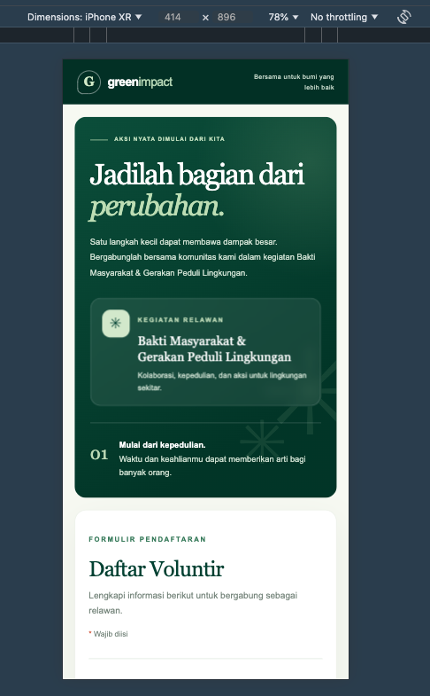
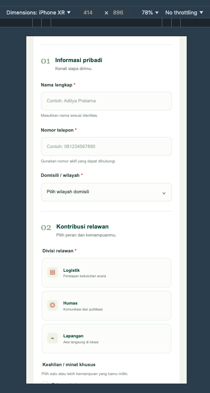
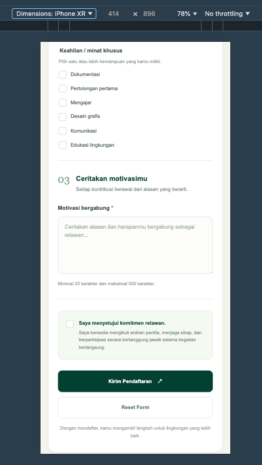
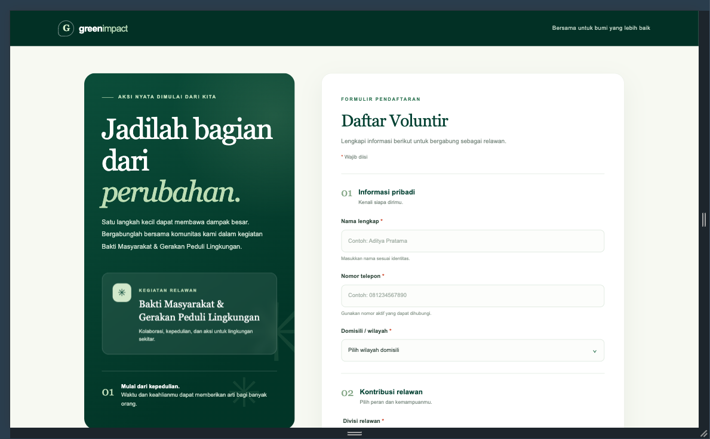
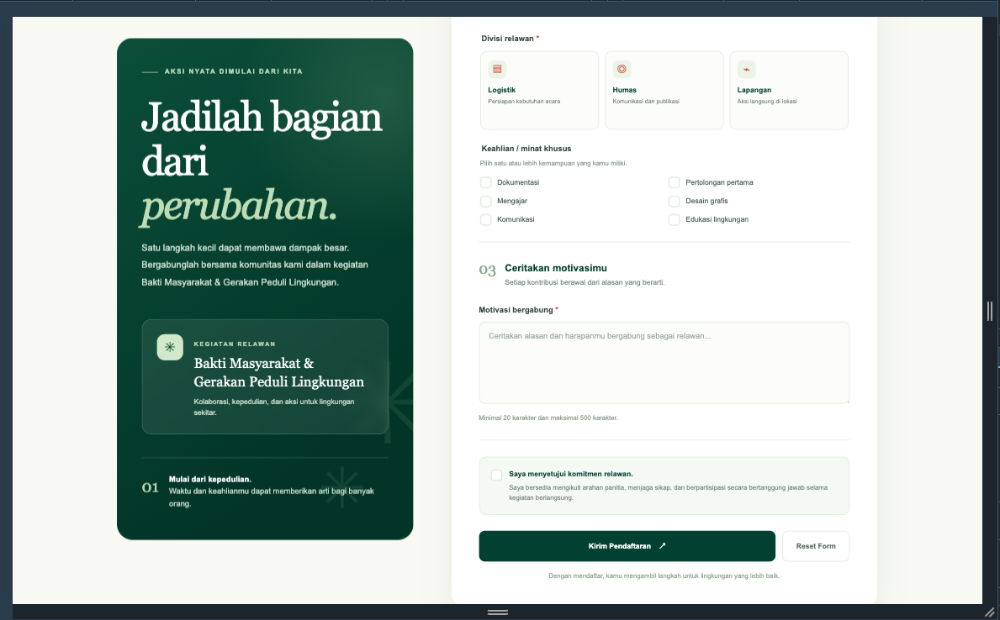

# Daftar Voluntir — Pertemuan 8

## Biodata Mahasiswa

|               |                                       |
| ------------- | ------------------------------------- |
| Nama          | Mochammad Jihan Isfalana              |
| NIM           | 4525210110                            |
| Program Studi | Teknik Informatika                    |
| Mata Kuliah   | Praktikum Desain Web                            |
| Kelas         | A - Lab AI                                     |
| Pertemuan     | 8 - HTML FORM LANJUTAN |

## Deskripsi
Halaman pendaftaran relawan untuk kegiatan **Bakti Masyarakat & Gerakan Peduli Lingkungan**. Proyek ini dibuat menggunakan HTML5 dan CSS3.

## Struktur Folder
```text
tugas-praktikum/
├── css/
│   └── style.css
├── images/
├── index.html
└── README.md
```

## Elemen Form
| Field | Elemen | Aturan |
|---|---|---|
| Nama lengkap | `input type="text"` | `required`, `minlength="3"`, `maxlength="80"` |
| Nomor telepon | `input type="tel"` | `required`, `pattern`, `minlength`, `maxlength` |
| Domisili | `select` | `required` |
| Divisi | `input type="radio"` | Satu grup `name`, `required` |
| Keahlian | `input type="checkbox"` | Pilihan independen |
| Motivasi | `textarea` | `required`, `minlength="20"`, `maxlength="500"` |
| Komitmen | `input type="checkbox"` | `required` |

## Validasi HTML5
1. Nama wajib diisi dan minimal 3 karakter.
2. Nomor telepon wajib diawali `08` dan berisi 10–13 digit.
3. Domisili wajib dipilih dari dropdown.
4. Salah satu divisi wajib dipilih.
5. Motivasi wajib diisi minimal 20 karakter.
6. Persetujuan komitmen wajib dicentang.

Checkbox keahlian bersifat opsional karena studi kasus tidak menyatakan bahwa pengguna wajib memiliki salah satu keahlian.

## Catatan Pengiriman Data
Halaman ini adalah implementasi front-end statis. `action="#"` merupakan placeholder dan belum mengirim data ke database atau server. Agar pendaftaran benar-benar tersimpan, atribut `action` perlu diarahkan ke endpoint backend dan server wajib memvalidasi ulang seluruh data.

## Skenario Uji Validasi
| No. | Field | Input uji | Hasil yang diharapkan |
|---|---|---|---|
| 1 | Nama | Kosong | Browser menolak submit karena `required` |
| 2 | Nama | `Al` | Browser menolak karena kurang dari 3 karakter |
| 3 | Telepon | `08123abc` | Browser menolak karena tidak sesuai `pattern` |
| 4 | Domisili | Tidak memilih opsi | Browser menolak karena `required` |
| 5 | Divisi | Tidak memilih radio | Browser menolak karena `required` |
| 6 | Motivasi | `Saya ingin ikut` | Browser menolak karena kurang dari 20 karakter |
| 7 | Persetujuan | Tidak dicentang | Browser menolak karena `required` |

## Validasi yang Tetap Wajib di Server
Validasi browser membantu UX, tetapi dapat dilewati atau dimanipulasi. Server tetap harus memeriksa:
- Field wajib, panjang teks, dan format nomor telepon.
- Nilai domisili dan divisi agar hanya menerima opsi yang diizinkan.
- Isi motivasi dan pembersihan data untuk mencegah input berbahaya.
- Persetujuan komitmen.
- Pembatasan panjang request dan perlindungan dari spam sesuai kebutuhan aplikasi.

## Hasil Screenshot

### Mobile



### Desktop


---

&copy; Dokumen Laporan ini dibuat untuk memenuhi tugas praktikum Desain Web, Pertemuan 8, Mata Kuliah Praktikum Desain Web, Kelas A - Lab AI.
