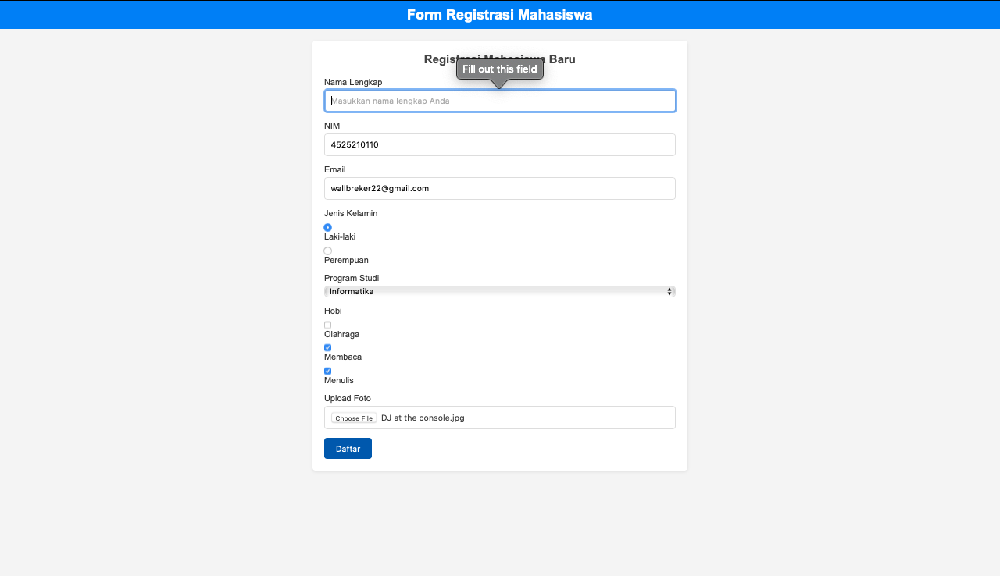
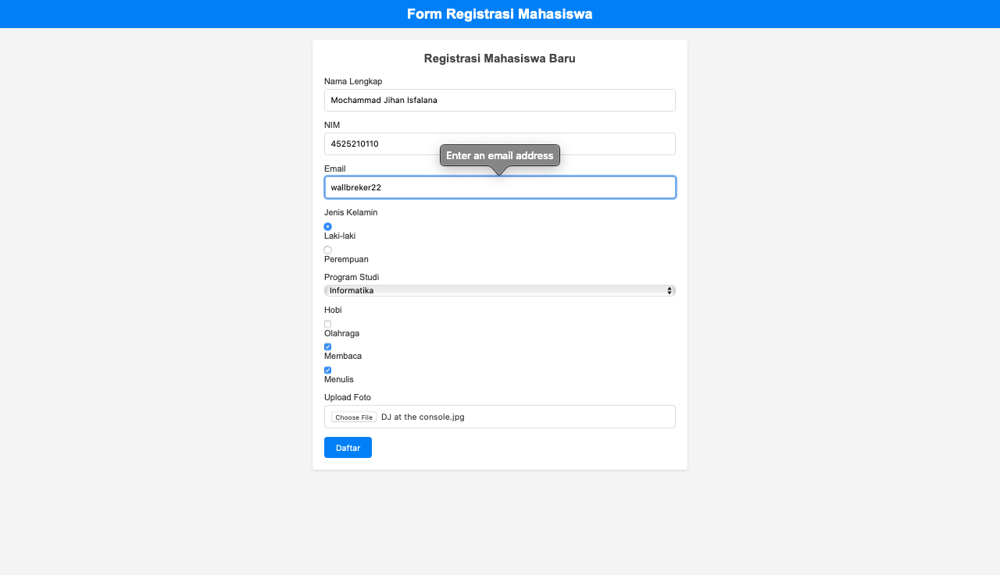
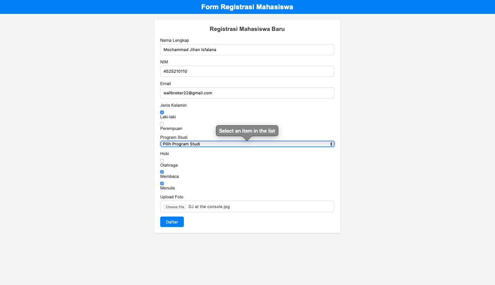
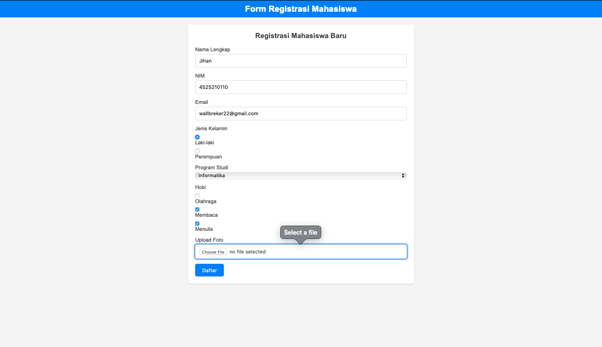
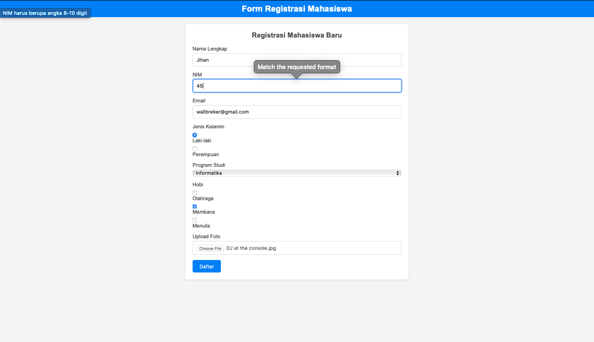
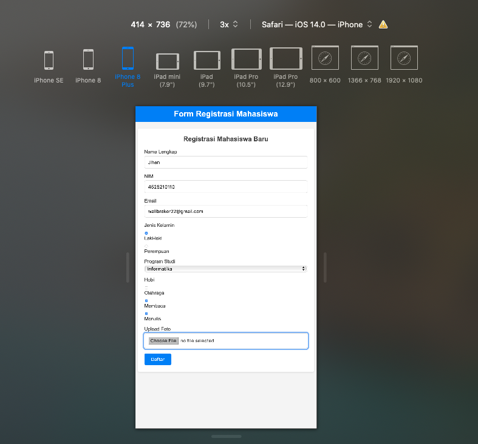

# Form Registrasi Mahasiswa

## Deskripsi

Proyek ini adalah implementasi sederhana dari **Form Registrasi Mahasiswa** menggunakan **HTML dan CSS murni**. Form ini dirancang untuk menerima data mahasiswa baru, seperti nama lengkap, NIM, email, jenis kelamin, program studi, hobi, dan foto. Validasi dasar dilakukan menggunakan atribut bawaan HTML seperti `required`, `pattern`, dan `accept`.

---

---

## Teknologi yang Digunakan

- **HTML5**: Untuk struktur dan elemen form.
- **CSS3**: Untuk styling dan tata letak form.
- **CSS External**: Semua styling diletakkan di file [`style.css`](command:_github.copilot.openRelativePath?%5B%7B%22scheme%22%3A%22file%22%2C%22authority%22%3A%22%22%2C%22path%22%3A%22%2FUsers%2Fmacbook%2FDocuments%2FKuliah_falan%2FPrak_DW_A_4525210110_MochammadJihanIsfalana%2FPertemuan%207%2FTugas%2Fcss%2Fstyle.css%22%2C%22query%22%3A%22%22%2C%22fragment%22%3A%22%22%7D%5D "/Users/macbook/Documents/Kuliah_falan/Prak_DW_A_4525210110_MochammadJihanIsfalana/Pertemuan 7/Tugas/css/style.css").

---

## Fitur

1. **Input Data Mahasiswa**:

   - Nama Lengkap (wajib diisi).
   - NIM (wajib diisi, validasi angka 8-10 digit).
   - Email (wajib diisi, validasi format email).
   - Jenis Kelamin (pilihan radio button).
   - Program Studi (dropdown menu).
   - Hobi (checkbox, dapat memilih lebih dari satu).
   - Upload Foto (hanya menerima file `.jpg` atau `.png`).

2. **Validasi Form**:

   - Semua input wajib diisi ([`required`](command:_github.copilot.openSymbolFromReferences?%5B%22required%22%2C%5B%7B%22uri%22%3A%7B%22%24mid%22%3A1%2C%22fsPath%22%3A%22%2FUsers%2Fmacbook%2FDocuments%2FKuliah_falan%2FPrak_DW_A_4525210110_MochammadJihanIsfalana%2FPertemuan%207%2FTugas%2Fmahasiswa.html%22%2C%22external%22%3A%22file%3A%2F%2F%2FUsers%2Fmacbook%2FDocuments%2FKuliah_falan%2FPrak_DW_A_4525210110_MochammadJihanIsfalana%2FPertemuan%25207%2FTugas%2Fmahasiswa.html%22%2C%22path%22%3A%22%2FUsers%2Fmacbook%2FDocuments%2FKuliah_falan%2FPrak_DW_A_4525210110_MochammadJihanIsfalana%2FPertemuan%207%2FTugas%2Fmahasiswa.html%22%2C%22scheme%22%3A%22file%22%7D%2C%22pos%22%3A%7B%22line%22%3A29%2C%22character%22%3A14%7D%7D%5D%5D "Go to definition")).
   - Validasi format NIM menggunakan [`pattern`](command:_github.copilot.openSymbolFromReferences?%5B%22pattern%22%2C%5B%7B%22uri%22%3A%7B%22%24mid%22%3A1%2C%22fsPath%22%3A%22%2FUsers%2Fmacbook%2FDocuments%2FKuliah_falan%2FPrak_DW_A_4525210110_MochammadJihanIsfalana%2FPertemuan%207%2FTugas%2Fmahasiswa.html%22%2C%22external%22%3A%22file%3A%2F%2F%2FUsers%2Fmacbook%2FDocuments%2FKuliah_falan%2FPrak_DW_A_4525210110_MochammadJihanIsfalana%2FPertemuan%25207%2FTugas%2Fmahasiswa.html%22%2C%22path%22%3A%22%2FUsers%2Fmacbook%2FDocuments%2FKuliah_falan%2FPrak_DW_A_4525210110_MochammadJihanIsfalana%2FPertemuan%207%2FTugas%2Fmahasiswa.html%22%2C%22scheme%22%3A%22file%22%7D%2C%22pos%22%3A%7B%22line%22%3A41%2C%22character%22%3A14%7D%7D%5D%5D "Go to definition").
   - Validasi format email menggunakan [`type="email"`](command:_github.copilot.openSymbolFromReferences?%5B%22type%3D%5C%22email%5C%22%22%2C%5B%7B%22uri%22%3A%7B%22%24mid%22%3A1%2C%22fsPath%22%3A%22%2FUsers%2Fmacbook%2FDocuments%2FKuliah_falan%2FPrak_DW_A_4525210110_MochammadJihanIsfalana%2FPertemuan%207%2FTugas%2Fcss%2Fstyle.css%22%2C%22external%22%3A%22file%3A%2F%2F%2FUsers%2Fmacbook%2FDocuments%2FKuliah_falan%2FPrak_DW_A_4525210110_MochammadJihanIsfalana%2FPertemuan%25207%2FTugas%2Fcss%2Fstyle.css%22%2C%22path%22%3A%22%2FUsers%2Fmacbook%2FDocuments%2FKuliah_falan%2FPrak_DW_A_4525210110_MochammadJihanIsfalana%2FPertemuan%207%2FTugas%2Fcss%2Fstyle.css%22%2C%22scheme%22%3A%22file%22%7D%2C%22pos%22%3A%7B%22line%22%3A69%2C%22character%22%3A6%7D%7D%2C%7B%22uri%22%3A%7B%22%24mid%22%3A1%2C%22fsPath%22%3A%22%2FUsers%2Fmacbook%2FDocuments%2FKuliah_falan%2FPrak_DW_A_4525210110_MochammadJihanIsfalana%2FPertemuan%207%2FTugas%2Fmahasiswa.html%22%2C%22external%22%3A%22file%3A%2F%2F%2FUsers%2Fmacbook%2FDocuments%2FKuliah_falan%2FPrak_DW_A_4525210110_MochammadJihanIsfalana%2FPertemuan%25207%2FTugas%2Fmahasiswa.html%22%2C%22path%22%3A%22%2FUsers%2Fmacbook%2FDocuments%2FKuliah_falan%2FPrak_DW_A_4525210110_MochammadJihanIsfalana%2FPertemuan%207%2FTugas%2Fmahasiswa.html%22%2C%22scheme%22%3A%22file%22%7D%2C%22pos%22%3A%7B%22line%22%3A25%2C%22character%22%3A14%7D%7D%5D%5D "Go to definition").
   - Validasi file upload menggunakan [`accept`](command:_github.copilot.openSymbolFromReferences?%5B%22accept%22%2C%5B%7B%22uri%22%3A%7B%22%24mid%22%3A1%2C%22fsPath%22%3A%22%2FUsers%2Fmacbook%2FDocuments%2FKuliah_falan%2FPrak_DW_A_4525210110_MochammadJihanIsfalana%2FPertemuan%207%2FTugas%2Fmahasiswa.html%22%2C%22external%22%3A%22file%3A%2F%2F%2FUsers%2Fmacbook%2FDocuments%2FKuliah_falan%2FPrak_DW_A_4525210110_MochammadJihanIsfalana%2FPertemuan%25207%2FTugas%2Fmahasiswa.html%22%2C%22path%22%3A%22%2FUsers%2Fmacbook%2FDocuments%2FKuliah_falan%2FPrak_DW_A_4525210110_MochammadJihanIsfalana%2FPertemuan%207%2FTugas%2Fmahasiswa.html%22%2C%22scheme%22%3A%22file%22%7D%2C%22pos%22%3A%7B%22line%22%3A110%2C%22character%22%3A14%7D%7D%5D%5D "Go to definition").

3. **Responsif**:
   - Form dirancang agar responsif dan dapat digunakan di perangkat desktop maupun mobile.

---

## Cara Menjalankan

1. Pastikan semua file berada dalam struktur folder yang benar.
2. Buka file `mahasiswa.html` menggunakan browser.
3. Isi form dengan data yang sesuai.
4. Klik tombol **Daftar** untuk mengirimkan data.

---

## Screenshot

### Tampilan Desktop

## 

## 

## 

## 

### Tampilan Mobile

---

## Masalah dan Solusi

### Masalah

1. **Validasi NIM**:

   - Awalnya, validasi NIM tidak membatasi panjang karakter.
   - Solusi: Menambahkan atribut [`pattern="[0-9]{8,10}"`](command:_github.copilot.openSymbolFromReferences?%5B%22pattern%3D%5C%22%5B0-9%5D%7B8%2C10%7D%5C%22%22%2C%5B%7B%22uri%22%3A%7B%22%24mid%22%3A1%2C%22fsPath%22%3A%22%2FUsers%2Fmacbook%2FDocuments%2FKuliah_falan%2FPrak_DW_A_4525210110_MochammadJihanIsfalana%2FPertemuan%207%2FTugas%2Fmahasiswa.html%22%2C%22external%22%3A%22file%3A%2F%2F%2FUsers%2Fmacbook%2FDocuments%2FKuliah_falan%2FPrak_DW_A_4525210110_MochammadJihanIsfalana%2FPertemuan%25207%2FTugas%2Fmahasiswa.html%22%2C%22path%22%3A%22%2FUsers%2Fmacbook%2FDocuments%2FKuliah_falan%2FPrak_DW_A_4525210110_MochammadJihanIsfalana%2FPertemuan%207%2FTugas%2Fmahasiswa.html%22%2C%22scheme%22%3A%22file%22%7D%2C%22pos%22%3A%7B%22line%22%3A41%2C%22character%22%3A14%7D%7D%5D%5D "Go to definition") untuk memastikan NIM hanya berupa angka dengan panjang 8-10 digit.

2. **Responsivitas**:

   - Form terlihat tidak rapi di layar kecil.
   - Solusi: Menambahkan properti CSS seperti [`width: 90%`](command:_github.copilot.openSymbolFromReferences?%5B%22width%3A%2090%25%22%2C%5B%7B%22uri%22%3A%7B%22%24mid%22%3A1%2C%22fsPath%22%3A%22%2FUsers%2Fmacbook%2FDocuments%2FKuliah_falan%2FPrak_DW_A_4525210110_MochammadJihanIsfalana%2FPertemuan%207%2FTugas%2Fcss%2Fstyle.css%22%2C%22external%22%3A%22file%3A%2F%2F%2FUsers%2Fmacbook%2FDocuments%2FKuliah_falan%2FPrak_DW_A_4525210110_MochammadJihanIsfalana%2FPertemuan%25207%2FTugas%2Fcss%2Fstyle.css%22%2C%22path%22%3A%22%2FUsers%2Fmacbook%2FDocuments%2FKuliah_falan%2FPrak_DW_A_4525210110_MochammadJihanIsfalana%2FPertemuan%207%2FTugas%2Fcss%2Fstyle.css%22%2C%22scheme%22%3A%22file%22%7D%2C%22pos%22%3A%7B%22line%22%3A33%2C%22character%22%3A2%7D%7D%2C%7B%22uri%22%3A%7B%22%24mid%22%3A1%2C%22fsPath%22%3A%22%2FUsers%2Fmacbook%2FDocuments%2FKuliah_falan%2FPrak_DW_A_4525210110_MochammadJihanIsfalana%2FPertemuan%207%2FTugas%2Fmahasiswa.html%22%2C%22external%22%3A%22file%3A%2F%2F%2FUsers%2Fmacbook%2FDocuments%2FKuliah_falan%2FPrak_DW_A_4525210110_MochammadJihanIsfalana%2FPertemuan%25207%2FTugas%2Fmahasiswa.html%22%2C%22path%22%3A%22%2FUsers%2Fmacbook%2FDocuments%2FKuliah_falan%2FPrak_DW_A_4525210110_MochammadJihanIsfalana%2FPertemuan%207%2FTugas%2Fmahasiswa.html%22%2C%22scheme%22%3A%22file%22%7D%2C%22pos%22%3A%7B%22line%22%3A4%2C%22character%22%3A35%7D%7D%5D%5D "Go to definition") dan `max-width: 600px` untuk memastikan form tetap responsif.

3. **Upload Foto**:
   - Tidak ada validasi untuk format file.
   - Solusi: Menambahkan atribut [`accept=".jpg,.png"`](command:_github.copilot.openSymbolFromReferences?%5B%22accept%3D%5C%22.jpg%2C.png%5C%22%22%2C%5B%7B%22uri%22%3A%7B%22%24mid%22%3A1%2C%22fsPath%22%3A%22%2FUsers%2Fmacbook%2FDocuments%2FKuliah_falan%2FPrak_DW_A_4525210110_MochammadJihanIsfalana%2FPertemuan%207%2FTugas%2Fmahasiswa.html%22%2C%22external%22%3A%22file%3A%2F%2F%2FUsers%2Fmacbook%2FDocuments%2FKuliah_falan%2FPrak_DW_A_4525210110_MochammadJihanIsfalana%2FPertemuan%25207%2FTugas%2Fmahasiswa.html%22%2C%22path%22%3A%22%2FUsers%2Fmacbook%2FDocuments%2FKuliah_falan%2FPrak_DW_A_4525210110_MochammadJihanIsfalana%2FPertemuan%207%2FTugas%2Fmahasiswa.html%22%2C%22scheme%22%3A%22file%22%7D%2C%22pos%22%3A%7B%22line%22%3A110%2C%22character%22%3A14%7D%7D%5D%5D "Go to definition") untuk membatasi jenis file yang dapat diunggah.

---

## Penulis

Nama: Mochammad Jihan Isfalana  
NIM: 4525210110  
Mata Kuliah: Praktikum Desain Web - A  
Pertemuan: 7
