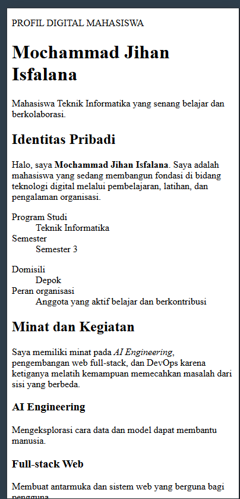
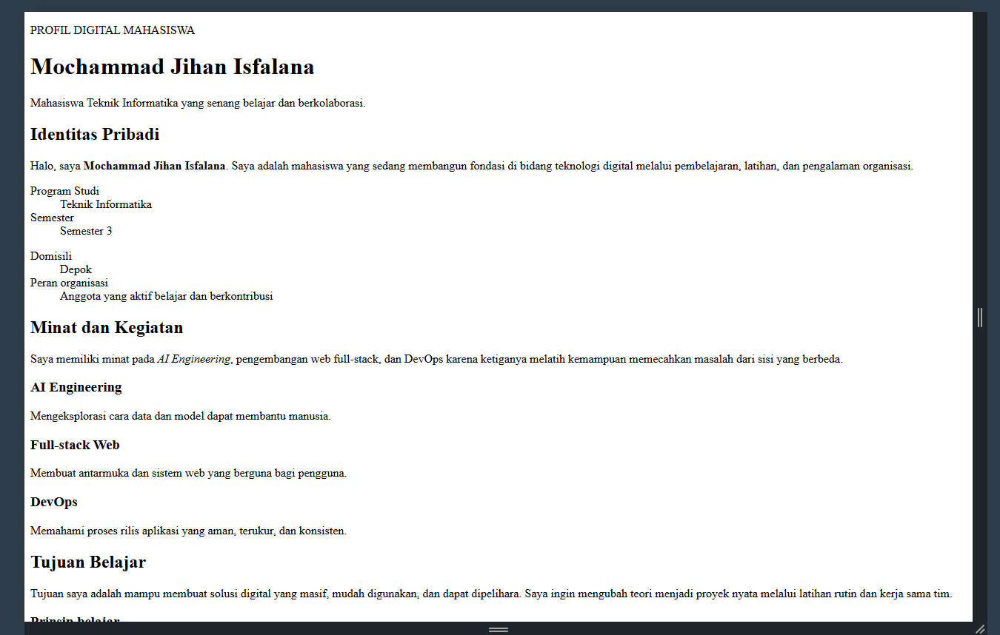

# Halaman Biodata Pribadi

## Deskripsi

Halaman ini merupakan profil digital sederhana untuk memperkenalkan
Mochammad Jihan Isfalana pada kegiatan organisasi kampus. Struktur informasi
dibagi menjadi identitas pribadi, minat dan kegiatan, tujuan belajar, serta
keterangan hak cipta. Fokus tugas adalah penggunaan HTML dasar yang benar,
hierarki heading, dan penyampaian informasi yang mudah dibaca.

## Struktur file

- [`prak1_latihan1.html`](./prak1_latihan1.html) — source code halaman biodata.
- `README.md` — dokumentasi, ringkasan perubahan, dan pembagian peran.

## Pemeriksaan kebutuhan tugas

Source memuat satu `h1`, beberapa `h2` dan `h3`, lebih dari empat paragraf,
`strong`, `em`, `br`, serta tiga HTML entity: `&copy;`, `&mdash;`, dan
`&amp;`. Layout memiliki aturan responsive sehingga tampilan menyesuaikan
desktop dan mobile.

## Ringkasan perubahan, masalah, dan solusi

Halaman latihan awal masih berupa biodata linear tanpa pembagian informasi
yang jelas. Perubahan utama adalah menyusun ulang konten menjadi identitas
pribadi, minat dan kegiatan, serta tujuan belajar menggunakan elemen
`header`, `main`, `section`, `article`, dan `footer`. Saya menambahkan
hierarki heading yang konsisten dengan satu `h1`, beberapa `h2`, dan `h3`,
kemudian memenuhi kebutuhan tugas melalui paragraf deskriptif, penekanan
`strong` dan `em`, line break, serta entity HTML pada bagian hak cipta.
Masalah yang perlu diperhatikan adalah halaman harus tetap mudah dibaca pada
layar kecil tanpa mengutamakan dekorasi. Solusinya adalah CSS sederhana
dengan grid yang berubah menjadi satu kolom melalui media query. Warna,
jarak, dan kontras juga dibuat konsisten agar informasi cepat dipindai.
Hasil akhirnya tetap ringan karena hanya menggunakan satu file HTML tanpa
library atau dependency eksternal. Selain memenuhi checklist, struktur ini
memudahkan anggota kelompok mengembangkan konten berikutnya tanpa mengubah
kerangka utama. Pengujian dilakukan dengan membuka file langsung di browser,
memeriksa hierarki pada accessibility tree, dan memastikan kolom informasi
berubah menjadi satu kolom pada lebar layar mobile.

## Bukti tampilan

### Hasil 390px

### Hasil 1280px

## Pembagian peran kelompok

Template pembagian peran yang dapat disesuaikan:

- **Anggota 1 — Struktur HTML:** menyusun semantic layout dan hierarki heading.
- **Anggota 2 — Konten:** menulis biodata, minat, tujuan, dan hak cipta.
- **Anggota 3 — Styling & responsive:** membuat tampilan desktop/mobile.
- **Anggota 4 — Dokumentasi & pengujian:** mengambil screenshot dan memeriksa
  seluruh requirement.
