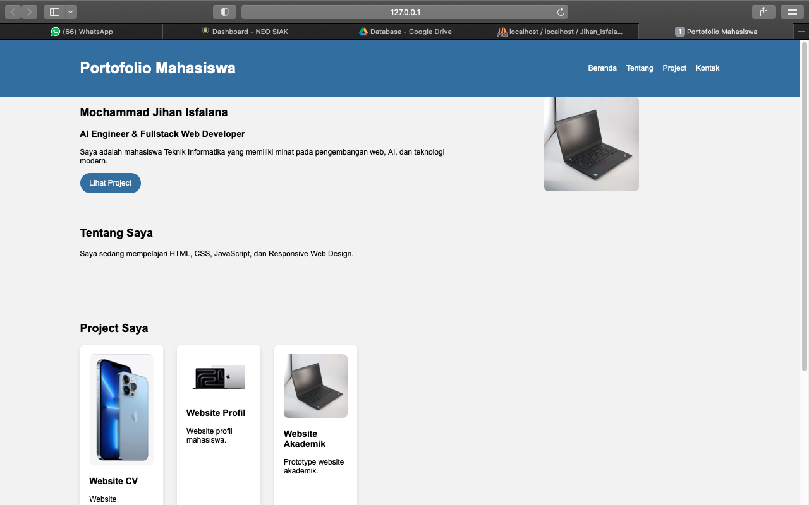
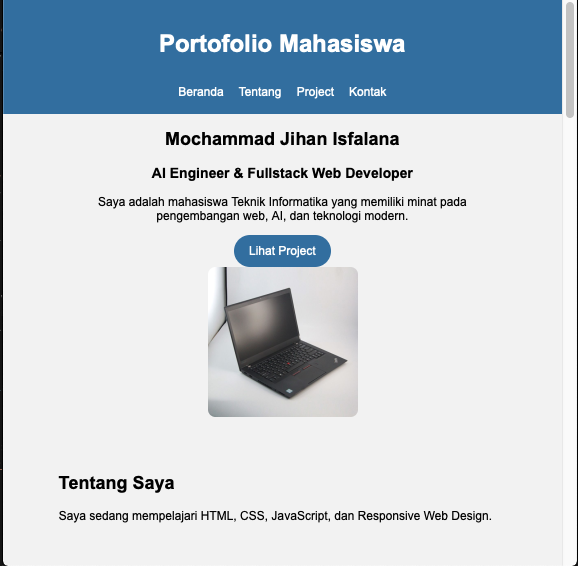

# Tugas Praktikum — Responsive Web Design

```Identitas
NAMA: Mochammad Jihan Isfalana
NPM: 4525210110
Mata Kuliah: Prak. Desain Web A
```

## Deskripsi

Project ini merupakan tugas praktikum pembuatan halaman profil/portofolio mahasiswa menggunakan **HTML5 dan CSS**.

Halaman dibuat dengan menerapkan beberapa konsep dasar CSS yang telah dipelajari, yaitu:

- Box Model
- Class dan ID Selector
- Flexbox
- Responsive Web Design
- Media Query
- Hover Effect
- Sticky Header
- External CSS

Project ini dibuat dalam bentuk halaman portofolio sederhana yang terdiri dari bagian Header, Hero, Tentang Saya, Project, Kontak, dan Footer.

---

## Tujuan

Tujuan dari pembuatan project ini adalah:

1. Memahami penggunaan struktur HTML5.
2. Memisahkan HTML dan CSS menggunakan external stylesheet.
3. Menerapkan konsep Box Model pada elemen halaman.
4. Menggunakan class yang dapat digunakan kembali (reusable).
5. Mengatur layout menggunakan Flexbox.
6. Membuat tampilan responsive menggunakan Media Query.
7. Menerapkan efek hover pada tombol dan kartu project.
8. Membuat navigasi dengan posisi sticky.
9. Membuat tampilan portofolio yang lebih rapi dan modern.

---

## Hasil Screenshot

### Desktop



### Media Responsive (Misal Tablet)


