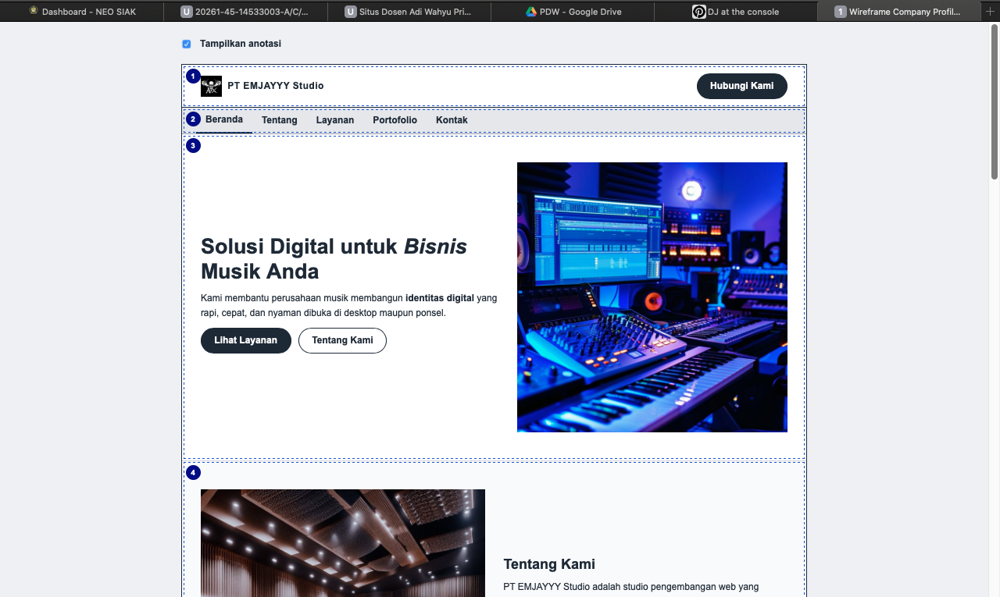
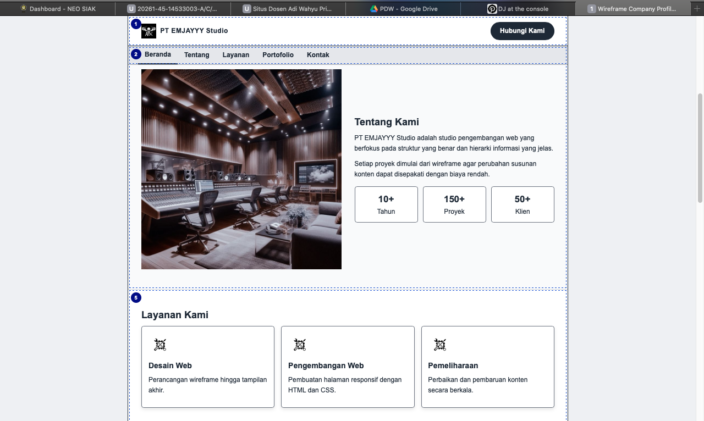
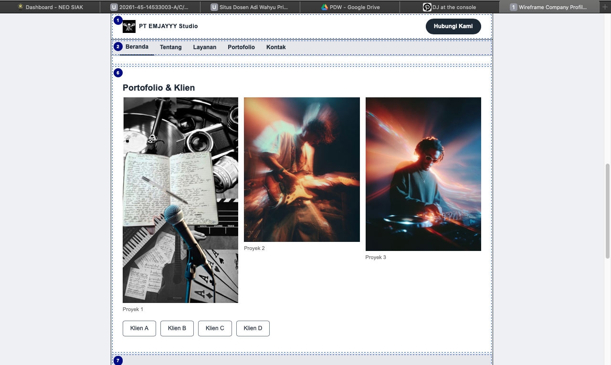
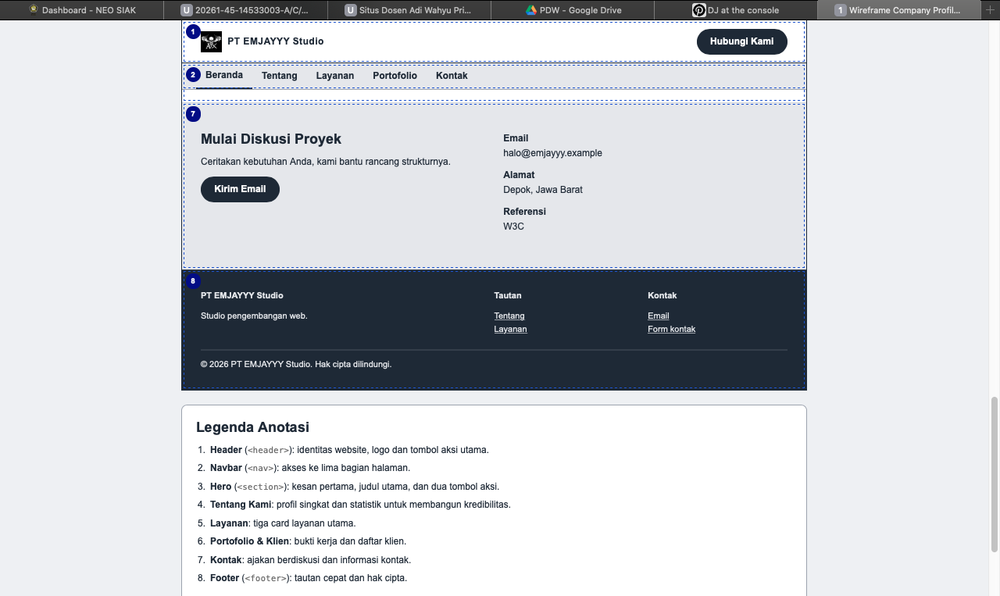
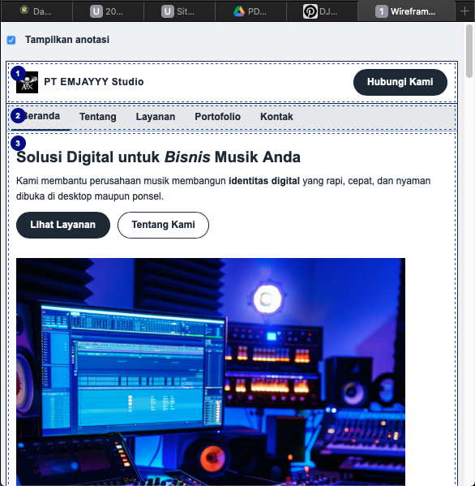
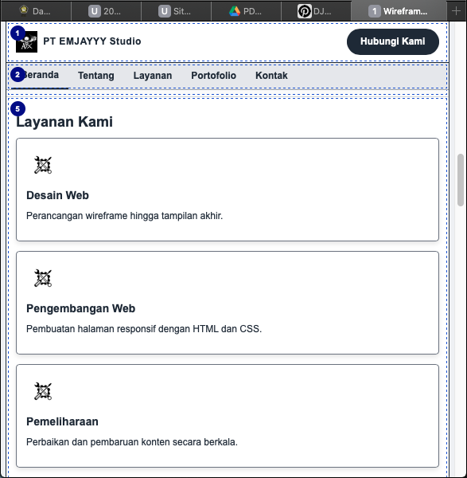
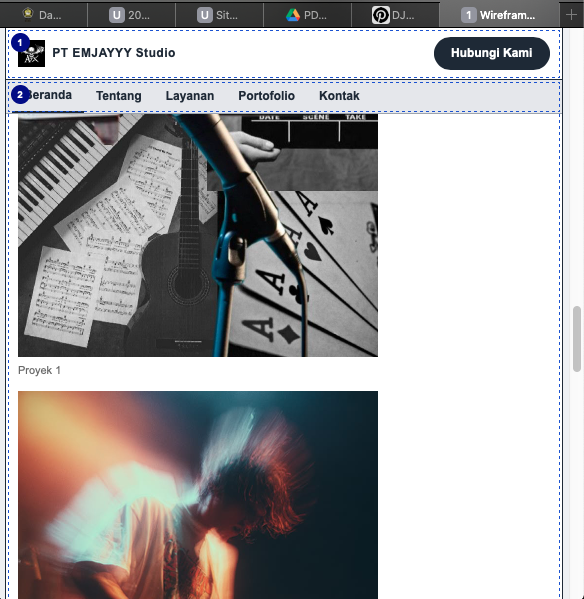

# Tugas Pertemuan 5 - Wireframe Company Profile

## Biodata Mahasiswa

|               |                                       |
| ------------- | ------------------------------------- |
| Nama          | Mochammad Jihan Isfalana              |
| NIM           | (isi NIM)                             |
| Program Studi | Teknik Informatika                    |
| Universitas   | Universitas Pancasila                 |
| Mata Kuliah   | Desain Web                            |
| Kelas         | A                                     |
| Pertemuan     | 5 - Struktur UI/UX dan Layout Website |

## Deskripsi Tugas

**Studi kasus.** Sebuah tim akan membuat portal berita, toko online, atau company profile. Sebelum coding, klien sering mengubah susunan konten, sehingga wireframe dibuat agar perubahan struktur dapat disepakati dengan biaya rendah sebelum desain high fidelity dan implementasi.

**Perintah.** Pilih salah satu: portal berita, toko online, atau company profile. Buat wireframe desktop dan mobile lengkap dengan anotasi fungsi setiap area.

**Pilihan saya.** Company profile (PT EMJAYYY Studio), memakai navbar tanpa sidebar.

**Bukti yang dikumpulkan.**

- Source code/folder project (`index.html`, `css/style.css`, `images/`)
- Screenshot hasil pada desktop dan mobile
- Ringkasan 150-250 kata mengenai perubahan, masalah, dan solusi

## Hasil Screenshot

### Desktop

## 

## 

## 

## 

### Mobile

## 

## 

## 

## Penjelasan / Ringkasan (151 kata)

Tugas ini membuat wireframe company profile untuk PT EMJAYYY Studio yang dapat dibaca pada desktop dan mobile. Struktur memakai elemen semantik HTML5 dengan satu h1, beberapa h2 dan h3, serta komentar penanda tiap bagian. Materi sebelumnya diterapkan langsung: gambar ber-alt dari folder images, tautan internal, eksternal, dan mailto, tiga jenis list, serta HTML entity. Gaya ditulis terpisah di css/style.css dengan class yang dipakai ulang, box-sizing border-box, flexbox, grid, dan empat format warna. Masalah utamanya adalah klien sering mengubah susunan konten, sehingga struktur perlu disepakati sebelum desain akhir. Solusinya, setiap area diberi nomor anotasi beserta fungsinya. Navbar dipilih dibanding sidebar karena company profile bersifat linear. Pada layar di bawah 768 px, tiga card layanan berubah menjadi satu kolom dan menu bergulir horizontal. Setiap perubahan diuraikan berdasarkan masalah dan solusinya supaya mudah ditinjau kembali oleh dosen maupun klien nantinya. Seluruh halaman dibuat tanpa JavaScript agar mudah dirawat dan sesuai materi yang telah dipelajari.
