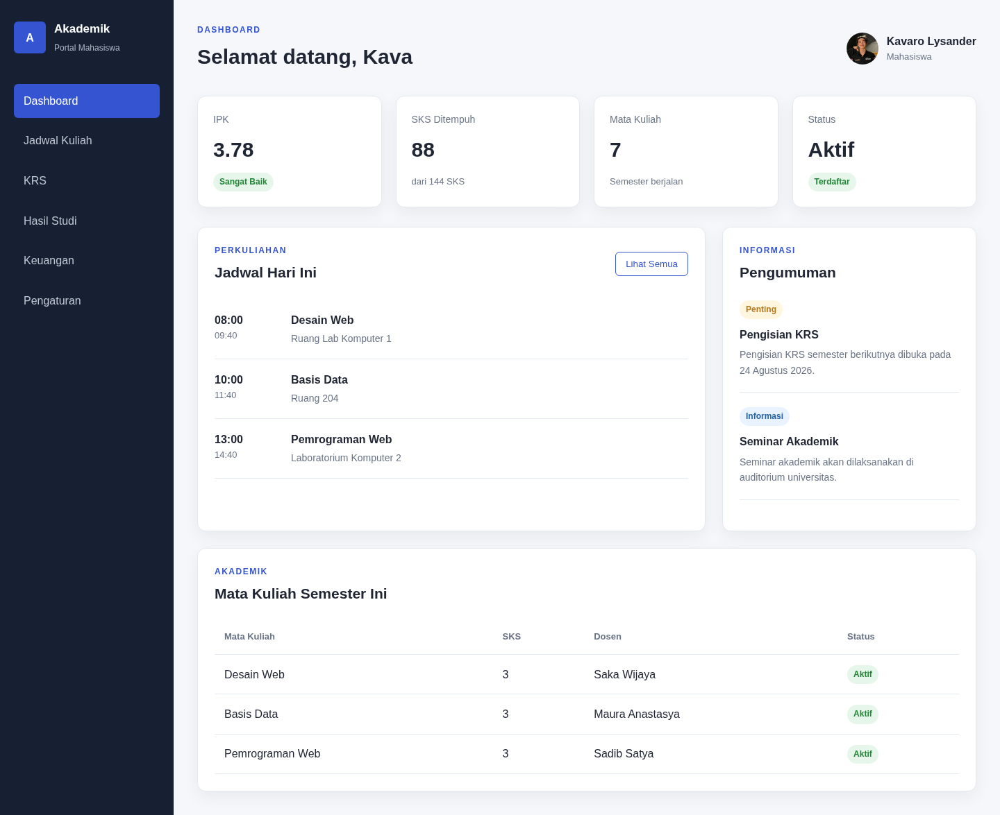
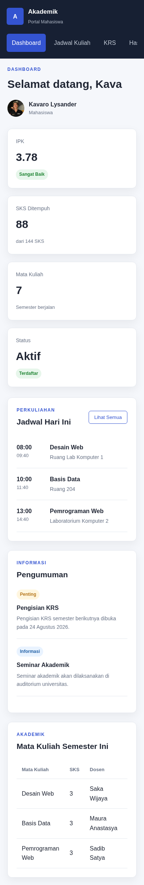
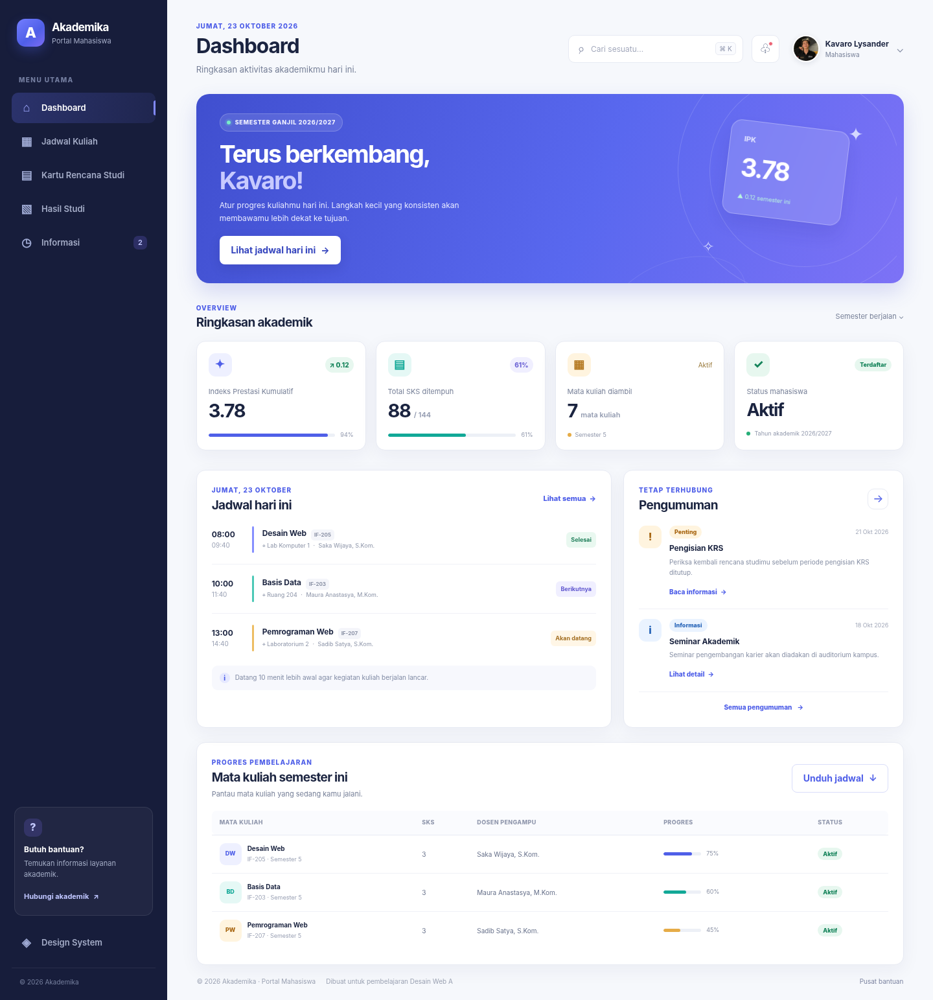
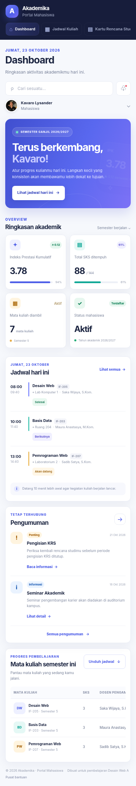
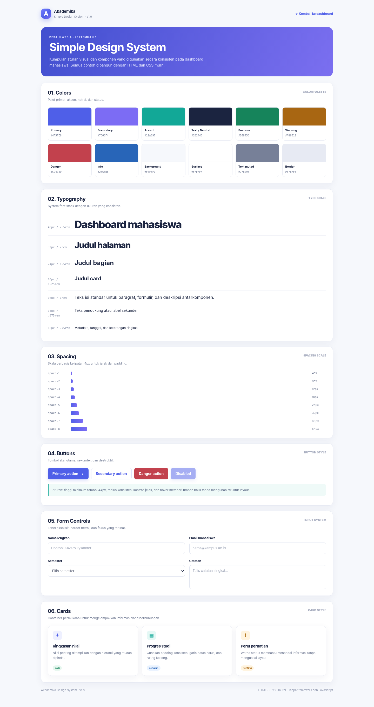
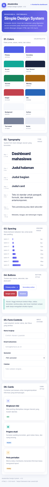

# **Tugas Pertemuan 6 - Simple Design System & Dashboard Mahasiswa**

## Biodata Mahasiswa

|               |                                       |
| ------------- | ------------------------------------- |
| Nama          | Mochammad Jihan Isfalana              |
| NIM           | 4525210110                            |
| Program Studi | Teknik Informatika                    |
| Mata Kuliah   | Desain Web                            |
| Kelas         | A - Lab AI                                     |
| Pertemuan     | 6 - Mockup, Visual Hierarchy, Warna, dan Tipografi |

## Deskripsi Tugas

**Dasar pengerjaan.** Mengembangkan kode contoh **`Contoh2`** yang berisi dashboard mahasiswa menggunakan HTML dan CSS. Struktur utamanya dipertahankan (navigasi, ringkasan akademik, jadwal, pengumuman, dan tabel mata kuliah), lalu visualnya dikembangkan memakai Simple Design System. Seluruh implementasi menggunakan HTML5 dan CSS murni, tanpa framework atau JavaScript.

**Ketentuan.** Design System mencakup colors, typography, spacing, buttons, form controls, dan cards. Mockup memakai color palette, type scale, button style, card style, serta layout responsif untuk desktop dan mobile.

**Halaman dokumentasi.** Buka [`DesignSystem/index.html`](DesignSystem/index.html) untuk melihat contoh visual tiap bagian design system.

## Struktur Folder

```text
Pertemuan6/
├── Contoh1/
├── Contoh2/
└── Tugas/
    ├── css/
    │   └── style.css                                
    ├── DesignSystem/
    │   ├── design-system-desktop.png
    │   └── design-system-mobile.png
    ├── images/
    │   ├── after-desktop.png
    │   ├── after-mobile.png
    │   ├── avatar.jpg
    │   ├── before-desktop.png
    │   ├── before-mobile.png             
    ├── index.html                   
    └── README.md
```

## Hasil Screenshot

### Sebelum Perubahan

**Desktop**



**Mobile**



### Sesudah Perubahan

**Desktop**



**Mobile**



## Design System - Tampilan Dokumentasi

Halaman dokumentasi menampilkan swatch warna, type scale, skala spacing, variasi tombol, form controls, serta contoh cards.

**Desktop**



**Mobile**



## Simple Design System

| Bagian | Aturan yang digunakan |
| --- | --- |
| Colors | Primary `#4F5FE8`, secondary `#7C6CF4`, accent `#12A897`, neutral, serta status success, warning, danger, dan info. |
| Typography | System font stack tanpa font eksternal ukuran 12, 14, 16, 18, 20, 24, 32, dan ukuran judul fluid. Line-height dibedakan untuk heading dan body. |
| Spacing | Skala berbasis 4px: 4, 8, 12, 16, 24, 32, 48, dan 64px. |
| Buttons | Primary, secondary, light, danger, dan disabled tinggi minimum 44px, radius konsisten, serta hover/focus state. |
| Form controls | Input, search, select, textarea, label yang terhubung melalui atribut `for`/`id`, dan indikator fokus. |
| Cards | Surface putih, border netral, radius 14px, shadow halus, padding seragam, dan hover ringan. |

Token warna, tipografi, spacing, radius, dan shadow didefinisikan sebagai CSS custom properties di bagian `:root` pada `css/style.css`.

## Ringkasan

Tugas ini mengembangkan dashboard mahasiswa dari source Contoh2 menjadi mockup dengan sistem visual yang konsisten dan responsif. Struktur utama—navigasi, ringkasan akademik, jadwal, pengumuman, dan tabel mata kuliah—dipertahankan supaya fungsi contoh tetap dikenal. Perubahan terbesar terletak pada hierarki visual: hero banner menjadi sorotan, judul dan eyebrow memakai skala konsisten, angka ringkasan diberi penekanan, sedangkan badge dan progress bar membantu membedakan status dan progres. Warna primary, secondary, accent, neutral, serta success, warning, danger, dan info ditetapkan sebagai CSS custom properties di `:root`. Skala tipografi memakai system font stack, sedangkan spacing mengikuti kelipatan 4px. Komponen tombol, form controls, status, dan card memakai class reusable agar tampilan lebih mudah dirawat. Karena dashboard awal tidak memuat kontrol form yang cukup, dibuat halaman Design System khusus untuk menampilkan button, input, select, textarea, kartu, palet warna, tipografi, dan spacing. Masalah layout utama adalah ruang sidebar dan dua kolom pada layar kecil solusinya ialah media query yang mengubah navigasi menjadi horizontal, merapikan header, membuat statistik dua kolom, dan menumpuk jadwal serta pengumuman. Tabel dapat digulir horizontal pada layar sempit. Seluruh proyek menggunakan HTML5 dan CSS murni tanpa framework atau JavaScript.

## Detail Perubahan, Masalah, dan Solusi

1. **Warna kurang terarah.** Versi awal memakai warna utama dan nilai warna yang tersebar di stylesheet. Solusinya, warna primer, sekunder, aksen, netral, dan status dijadikan CSS custom properties agar konsisten dan mudah diubah.
2. **Hierarki visual belum kuat.** Data, jadwal, dan informasi memiliki penekanan visual yang relatif serupa. Solusinya, ditambahkan hero banner, eyebrow, skala heading, variasi ukuran nilai, badge status, dan ruang kosong untuk membedakan prioritas konten.
3. **Komponen belum sepenuhnya seragam.** Tombol, kartu, label status, dan jarak antarbagian memiliki aturan yang berbeda. Solusinya, dibuat class reusable seperti `.card`, `.button`, `.status`, serta token radius dan spacing.
4. **Tampilan layar sempit berisiko padat.** Sidebar dan dua kolom utama memakan lebar pada ponsel. Solusinya, media query mengubah sidebar menjadi navigasi horizontal, menyusun konten menjadi satu kolom, dan menjaga kartu statistik dua kolom. Tabel tetap dapat digulir horizontal bila lebar layar tidak cukup.
5. **Form control tidak terlihat pada mockup utama.** Karena dashboard contoh tidak banyak memakai formulir, komponen input, select, dan textarea didokumentasikan dalam halaman Design System tersendiri agar semua komponen yang diminta dapat ditinjau.

## Cara Menjalankan

1. Ekstrak folder proyek.
2. Buka `index.html` menggunakan browser.
3. Klik menu **Design System** di sidebar untuk membuka dokumentasi komponen.
4. Untuk memeriksa versi mobile, gunakan Developer Tools browser dan aktifkan device emulation, atau buka halaman pada browser ponsel.

Dokumen ini dibuat oleh &copy; Mochammad Jihan Isfalana, 2026.