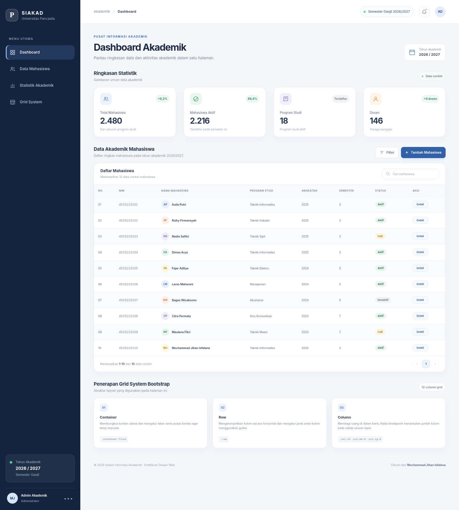
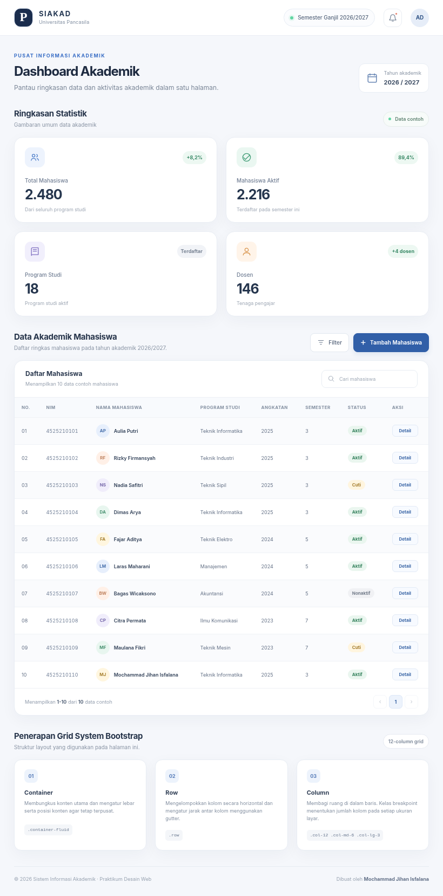
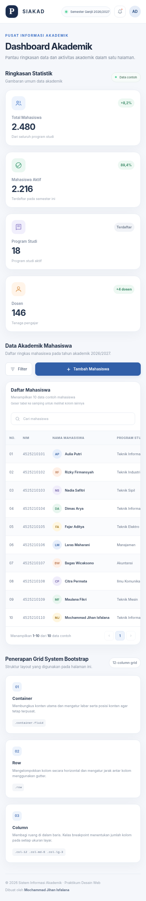

# Dashboard Akademik - Bootstrap 5

## Biodata

|               |                                       |
| ------------- | ------------------------------------- |
| Nama          | Mochammad Jihan Isfalana              |
| NIM           | 4525210110                            |
| Program Studi | Teknik Informatika                    |
| Mata Kuliah   | Desain Web                            |
| Kelas         | A - Lab AI                                     |
| Pertemuan     | 9 - Bootstrap Framework, Grid System dan Table Responsif |

## Deskripsi

Proyek ini merupakan implementasi **Dashboard Akademik** untuk menampilkan ringkasan informasi akademik dan daftar data mahasiswa. Halaman dibuat menggunakan **HTML5, CSS3, dan Bootstrap 5**. Bootstrap dipasang melalui CDN, sedangkan CSS tambahan disimpan secara terpisah di dalam folder `css`.

Dashboard dirancang dengan pendekatan *mobile-first* agar tampilan tetap terstruktur pada perangkat HP, tablet, dan laptop. Data yang ditampilkan merupakan **data contoh/dummy untuk kebutuhan praktikum**, bukan data akademik resmi atau data yang terhubung ke server.

---

## Analisis Modul Praktikum Pertemuan 9

Modul Pertemuan 9 membahas framework CSS, Bootstrap 5, pemasangan Bootstrap melalui CDN, grid system, breakpoint, kolom responsif, utility classes, komponen siap pakai, dan tabel Bootstrap.

### Materi utama yang diterapkan

1. **Framework CSS**: menggunakan class Bootstrap untuk mempercepat pembuatan tampilan.
2. **Bootstrap 5 melalui CDN**: file CSS dipanggil pada bagian `<head>`, sedangkan JavaScript Bundle diletakkan sebelum penutup `</body>`.
3. **Grid System**: menerapkan struktur `container`, `row`, dan `column` untuk menyusun konten.
4. **Breakpoint responsif**: menggunakan class `col-12`, `col-md-6`, dan `col-lg-3` pada empat kartu statistik.
5. **Utility Classes**: menggunakan utility Bootstrap untuk warna, jarak, alignment, display, dan ukuran teks.
6. **Komponen Card dan Button**: digunakan pada kartu statistik dan tombol aksi.
7. **Tabel Bootstrap**: memakai `table`, `table-striped`, `table-hover`, `table-responsive`, dan badge status.

### Ringkasan ketentuan tugas

| Ketentuan modul | Penerapan pada proyek |
|---|---|
| Dashboard akademik menggunakan Bootstrap 5 CDN | `index.html` menghubungkan Bootstrap 5.3.8 melalui CDN |
| Empat kartu statistik | Total Mahasiswa, Mahasiswa Aktif, Program Studi, dan Dosen |
| Grid 1 → 2 → 4 kolom | `col-12 col-md-6 col-lg-3` |
| Tabel minimal 10 baris | Terdapat 10 baris data mahasiswa contoh |
| `table-striped` dan `table-hover` | Diterapkan langsung pada elemen `<table>` |
| `table-responsive` | Tabel dibungkus dengan `<div class="table-responsive">` |
| Minimal tiga utility classes | Contoh: `d-none`, `d-lg-flex`, `g-3`, `mb-0`, `text-white`, `align-middle`, dan `h-100` |
| Badge atau button | Badge digunakan untuk status mahasiswa dan button untuk aksi |
| Penjelasan container, row, column | Dijelaskan di halaman dashboard dan bagian laporan ini |
| Screenshot tiga ukuran layar | Disediakan pada folder `dokumentasi` |

---

## Teknologi yang Digunakan

- **HTML5**: membangun struktur dan elemen semantik dashboard.
- **CSS3**: mengatur identitas visual, detail komponen, dan penyesuaian responsif.
- **Bootstrap 5.3.8**: menyediakan grid system, breakpoint, card, button, badge, utility classes, dan tabel.
- **Bootstrap CDN**: memuat file Bootstrap tanpa menyimpan library di dalam folder proyek.

---

## Fitur dan Bagian Halaman

1. **Header dan identitas sistem**: menampilkan identitas SIAKAD dan informasi tahun akademik.
2. **Navigasi sidebar**: navigasi dashboard yang tampil pada layar laptop/desktop.
3. **Empat kartu statistik**:
   - Total Mahasiswa: 2.480.
   - Mahasiswa Aktif: 2.216.
   - Program Studi: 18.
   - Dosen: 146.
4. **Tabel data mahasiswa**: berisi 10 baris contoh dengan kolom nomor, NIM, nama, program studi, angkatan, semester, status, dan aksi.
5. **Badge status**: membedakan status Aktif, Cuti, dan Nonaktif menggunakan warna.
6. **Tombol aksi**: tombol Filter, Tambah Mahasiswa, dan Detail.
7. **Footer**: menampilkan informasi praktikum dan identitas pembuat.
8. **Penjelasan grid system**: memberi keterangan penerapan container, row, dan column pada proyek.

---

## Penjelasan Grid System Bootstrap

Grid System Bootstrap menggunakan susunan bertingkat yang terdiri dari container, row, dan column.

### 1. Container

`container` atau `container-fluid` berfungsi sebagai pembungkus konten dan mengatur lebar serta posisi konten. Pada proyek ini, area konten utama menggunakan class `container-fluid`, lalu lebar maksimal dan padding visualnya disesuaikan melalui CSS agar area dashboard tetap memiliki batas lebar yang nyaman dibaca.

### 2. Row

`row` berfungsi untuk mengelompokkan kolom secara horizontal. Pada bagian kartu statistik, class `row g-3 g-xl-4` membentuk satu baris grid dan mengatur jarak antar kolom menggunakan gutter.

### 3. Column

`column` membagi ruang pada sebuah row. Setiap kartu statistik memakai class:

```html
<div class="col-12 col-md-6 col-lg-3">
```

Artinya:

- `col-12`: setiap kartu menggunakan lebar penuh pada layar kecil, sehingga tersusun satu kolom.
- `col-md-6`: mulai breakpoint `md`, setiap kartu menggunakan setengah lebar baris, sehingga tersusun dua kolom.
- `col-lg-3`: mulai breakpoint `lg`, setiap kartu menggunakan seperempat lebar baris, sehingga tersusun empat kolom.

Dengan demikian, empat kartu akan berubah dari **1 kolom → 2 kolom → 4 kolom** sesuai ukuran layar.

### Catatan breakpoint

Proyek menggunakan Bootstrap 5.3.8. Nilai breakpoint default pada versi ini adalah `sm` 576px, `md` 768px, `lg` 992px, `xl` 1200px, dan `xxl` 1400px. Modul menjelaskan breakpoint secara ilustratif untuk kategori perangkat, sedangkan class pada proyek mengikuti breakpoint bawaan Bootstrap 5.3.8.

---

## Struktur Folder

```text
tugas-praktikum/
├── index.html
├── README.md
├── css/
│   └── style.css
└── dokumentasi/
    ├── desktop.png
    ├── tablet.png
    └── mobile.png
```

---

## Screenshot Hasil

### Tampilan Laptop / Desktop



### Tampilan Tablet



### Tampilan HP / Mobile



---

## Perubahan, Masalah, dan Solusi

### 1. Susunan kartu statistik pada berbagai ukuran layar

- **Masalah**: empat kartu statistik tidak boleh tetap berjajar empat kolom pada layar kecil karena akan membuat isi terlalu sempit.
- **Solusi**: menerapkan `col-12 col-md-6 col-lg-3`. Kartu tampil satu kolom pada layar kecil, dua kolom mulai `md`, dan empat kolom mulai `lg`.

### 2. Tabel terlalu lebar untuk layar HP

- **Masalah**: tabel memiliki delapan kolom sehingga lebar keseluruhannya melebihi ruang layar ponsel.
- **Solusi**: membungkus tabel dengan `table-responsive`. Pada layar kecil, tabel dapat digeser secara horizontal tanpa merusak lebar layout halaman. Petunjuk geser juga ditampilkan pada tampilan mobile.

### 3. Tampilan Bootstrap perlu disesuaikan dengan identitas dashboard

- **Masalah**: komponen bawaan Bootstrap masih memiliki tampilan generik.
- **Solusi**: menambahkan `css/style.css` setelah CDN Bootstrap. CSS tambahan mengatur warna, tipografi, radius, bayangan, sidebar, avatar, dan status badge.

### 4. Perbedaan breakpoint pada materi dan versi Bootstrap yang digunakan

- **Masalah**: tabel breakpoint pada modul bersifat ilustratif dan tidak seluruh nilai lebarnya sama dengan default Bootstrap 5.3.8.
- **Solusi**: menggunakan nama breakpoint resmi Bootstrap 5.3.8 pada class grid, serta menguji hasilnya pada ukuran layar HP, tablet, dan laptop.

### 5. Data dan tombol belum terhubung ke backend

- **Masalah**: tugas praktikum berfokus pada tampilan HTML, CSS, dan Bootstrap, bukan implementasi sistem akademik penuh.
- **Solusi**: menggunakan data dummy dan tombol statis sebagai representasi antarmuka. Fungsionalitas CRUD dan integrasi database tidak ditambahkan di luar ruang lingkup tugas.

---

## Batasan Proyek

- Data statistik dan data mahasiswa hanya data contoh.
- Belum menggunakan JavaScript buatan sendiri.
- Tombol Filter, Tambah Mahasiswa, dan Detail belum menjalankan proses aplikasi.
- Tidak terdapat backend, autentikasi, atau koneksi database.
- Tampilan membutuhkan koneksi internet untuk memuat Bootstrap dari CDN.

---

## Penulis

**Nama**: Mochammad Jihan Isfalana  
**NIM**: 4525210110  
**Mata Kuliah**: Praktikum Desain Web - A  
**Pertemuan**: 9  
**Program Studi**: Teknik Informatika  
**Fakultas**: Teknik, Universitas Pancasila
